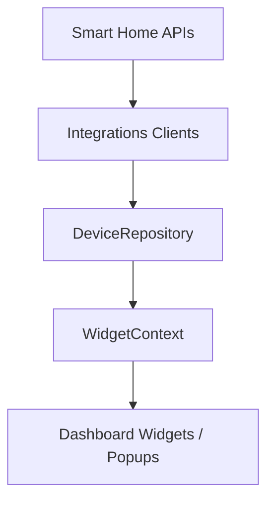
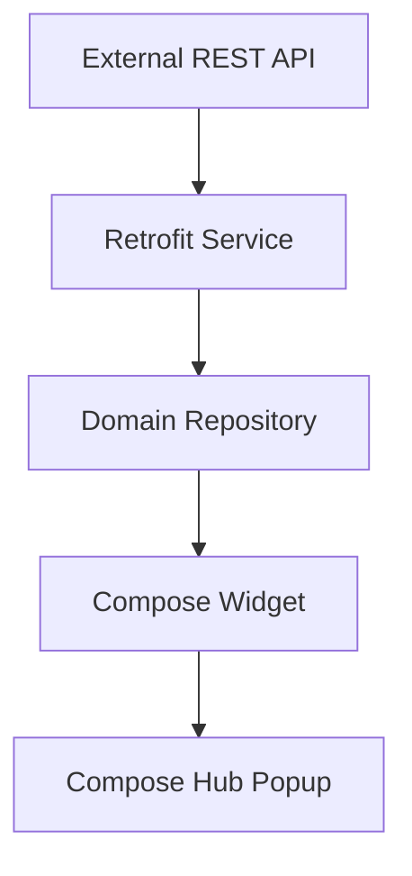

# Architecture Document

## Application Architecture
Clara Smart Home is an Android Launcher application built using Kotlin and Jetpack Compose.
The app employs a hybrid architecture:
1.  **Monolithic Core**: A tightly coupled system for controlling physical Smart Home devices (Lights, Thermostats, Cameras).
2.  **CWAS (Clara Widget Architecture Standard)**: A modern, modular, self-contained architecture used for isolated data-driven widgets.

## Data Flow

### Monolithic Core (Legacy)

- Data flows from various 3rd party APIs into integration clients, updating global `SmartTile` models within `DeviceRepository`.
- The `WidgetContext` pushes this massive state object to all legacy widgets.

### CWAS Widgets (Modern)

- Each widget controls its own isolated data flow and handles its own network calls asynchronously.

## Screen Flow
1. **MainActivity**: The primary launcher dashboard.
2. **SetupWizardScreen**: Handles onboarding and device pairings.
3. **AutomationsSection**: Used for configuring rules.
4. **Popups/Modals**: Detailed interaction layers overlaid on top of the dashboard.

## Service Interactions
- **Engines**: The app uses singleton "Engine" classes (e.g., `DeviceDispatchEngine`, `AutomationEngine`) running on background coroutine scopes to monitor state changes and push updates to the UI.

## Repository Pattern Usage
- **DeviceRepository**: The central store for smart home states. Needs refactoring.
- **Feature Repositories**: (e.g., `CommuteRepository`, `FootballRepository`) These are strictly scoped to their respective domains and abstract Retrofit API calls from the Compose layer.

## State Management
- Primarily handled through Jetpack Compose `MutableState` and `StateFlow` within ViewModels/Repositories. The legacy side passes state down via heavy data classes (`WidgetContext`), while the new side uses localized `remember { mutableStateOf() }`.

## Widget Architecture
Widgets are registered dynamically via `WidgetRegistry`.
- Legacy widgets are defined in `DefaultWidgetsRegistrar.kt` and use massive shared UI files.
- CWAS widgets are self-registering via a `<Feature>Manifest.kt` and encapsulate their entire stack.

## Dependency Flow
- The project primarily uses manual dependency injection or singleton object patterns. There is no heavy DI framework like Hilt or Dagger currently in place for the new modular widgets.
